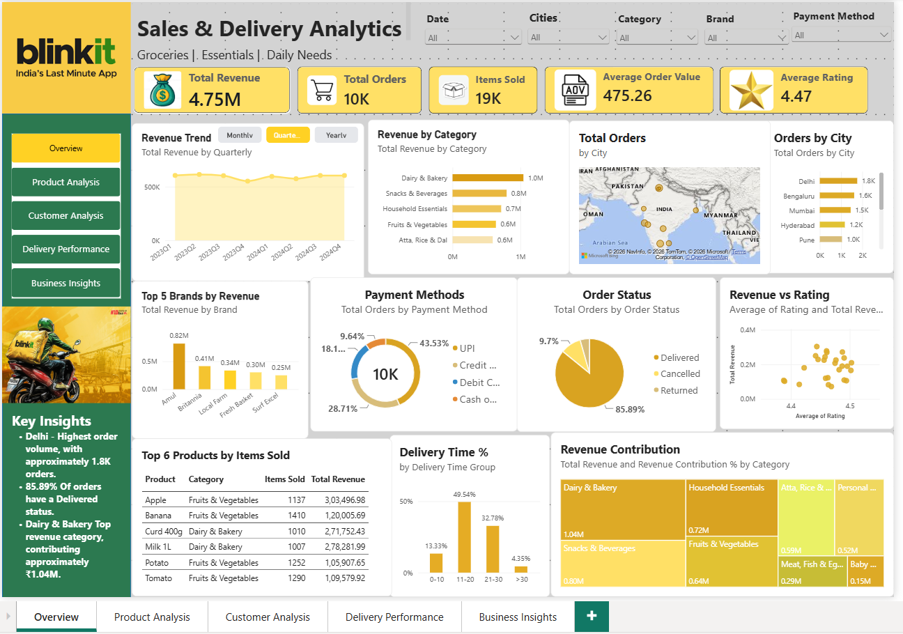
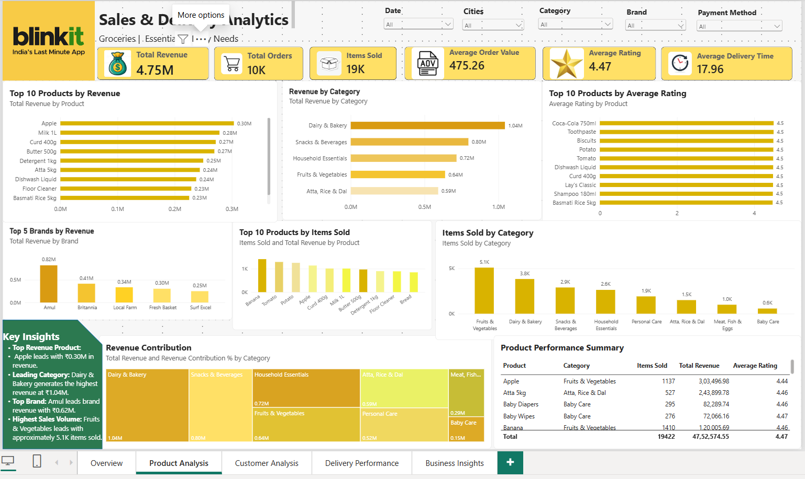
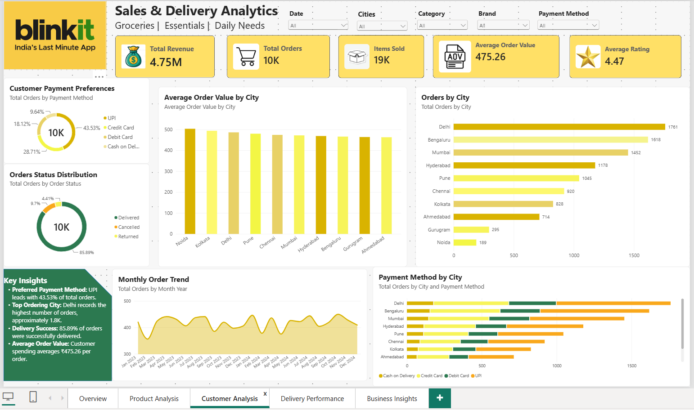
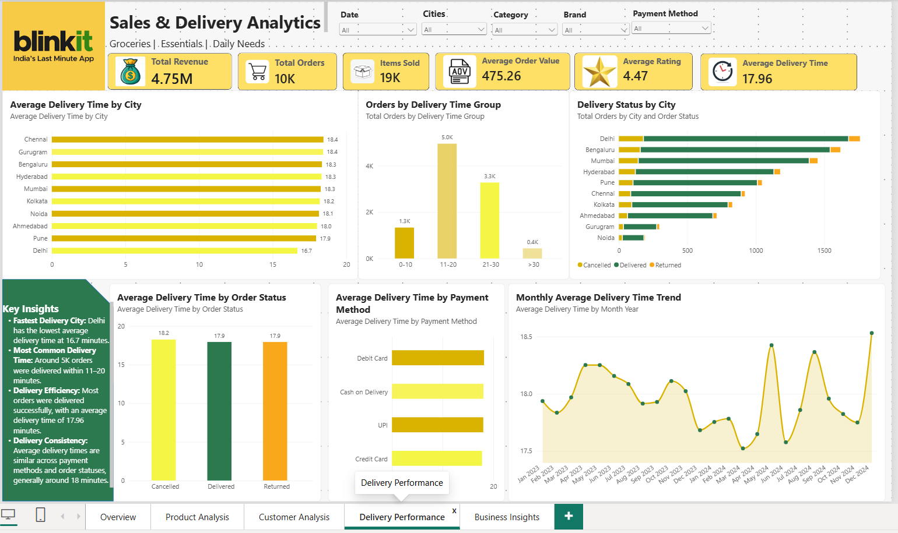
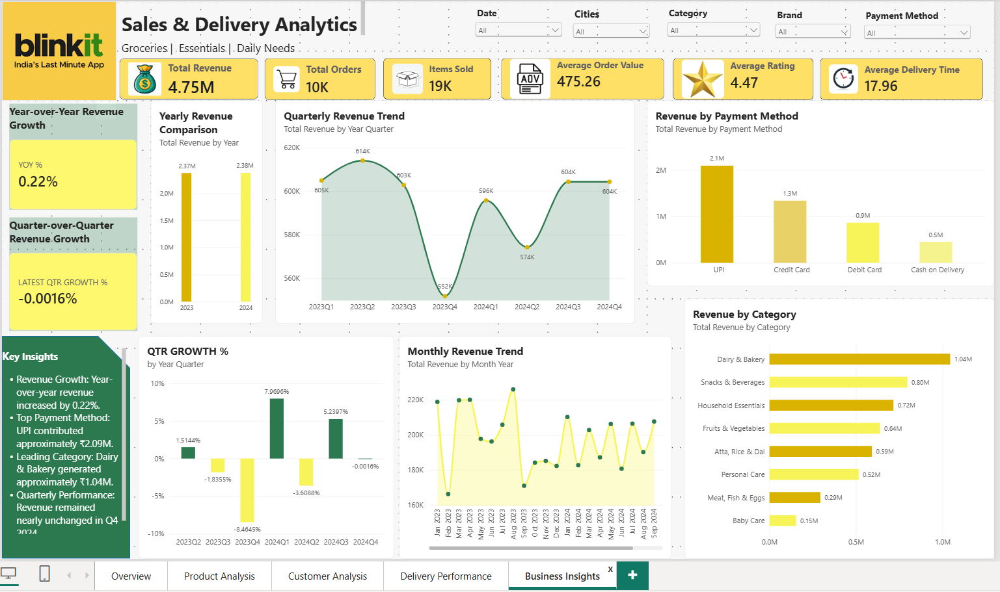

# Blinkit Sales & Delivery Analytics | Power BI

An interactive five-page Power BI dashboard analyzing grocery sales, product performance, customer behavior, delivery efficiency, and business growth using transactional data from 2023–2024.

## Tools & Technologies
- Microsoft Power BI
- Power Query
- DAX
- Data Modeling
- Data Visualization

## Dashboard KPIs
- **Total Revenue:** ₹47.5 lakh (4.75M)
- **Total Orders:** 10K
- **Items Sold:** 19K
- **Average Order Value:** ₹475.26
- **Average Customer Rating:** 4.47
- **Average Delivery Time:** 17.96 minutes

## Dashboard Pages
1. Overview – Executive-level performance monitoring.
2. Product Analysis – Product, brand, and category performance.
3. Customer Analysis – Order behavior, payment preferences, and city-level analysis.
4. Delivery Performance – Delivery time, status, and operational efficiency.
5. Business Insights – Revenue trends, growth metrics, and category contributions.

## Dashboard Screenshots

### 1. Overview

### 2. Product Analysis

### 3. Customer Analysis

### 4. Delivery Performance

### 5. Business Insights

## Key Business Insights
- Delhi recorded the highest order volume, approximately 1.8K orders.
- UPI accounted for approximately 43.53% of orders.
- Dairy & Bakery generated approximately ₹1.04M in revenue.
- Approximately 85.89% of orders were marked as delivered.
- Revenue increased by approximately 0.22% year over year.

## Project Objective
To transform transactional grocery delivery data into actionable business insights through an interactive business intelligence dashboard.

## Row-Level Security (RLS)

Implemented static Row-Level Security (RLS) in Power BI Desktop to demonstrate role-based data access.

**Security Configuration:**
- Role Name: `Delhi_Only`
- Table: `Cities`
- Column: `City`
- Filter Condition: `City = "Delhi"`

**Testing and Validation:**
- Tested the security role using Power BI Desktop's **View as** feature.
- Verified that only Delhi appeared in the Cities slicer.
- Confirmed that dashboard KPIs reflected the Delhi-filtered data.
- Delhi-filtered revenue: approximately ₹855.55K.
- Delhi-filtered orders: approximately 2K.

**Purpose:** Demonstrates how Row-Level Security can restrict report data visibility based on assigned roles.

*Note: RLS was implemented and tested locally in Power BI Desktop; it has not been deployed to Power BI Service.*
